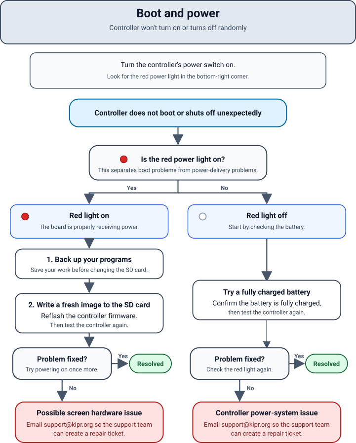
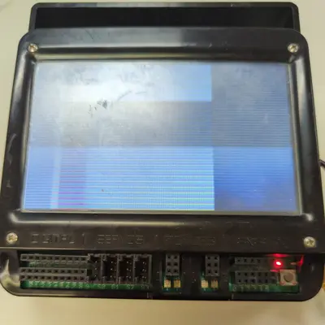

+++
title = "Controller won't turn on"
description = "The controller won't turn on, or turns off randomly."
+++

## Diagnosing

Boot and power problems on the Wombat fall into two categories, depending on whether the board is receiving power.
To tell them apart, turn the controller's power switch on and look for the red light in the bottom right corner.

## Red light on

If the red light is on, the board is receiving power.

1. [Back up your programs](/docs/backup_programs/).
1. [Write a new OS image to the microSD card](/docs/firmware_reflash/).

If this doesn't fix the problem, it is most likely an issue with the screen hardware.
In this case, 

## Red light off

Try a fully charged battery.
You can check the charge level by the lights on the charger included with your kit.

If this doesn't fix the problem, the fault is somewhere in the controller's power system.
In this case, 
