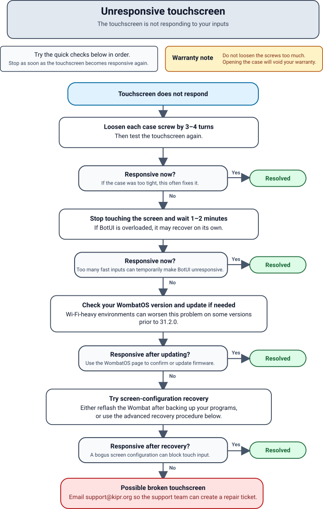

+++
title = 'Touchscreen is unresponsive'
description = 'The touchscreen is not responding to your inputs.'
+++



## Diagnosing

This is a fairly common problem on the Wombat with a variety of causes.
Work through the sections below in order.

## Overtightened case

Sometimes, if the top case is too tight, the touchscreen registers the case itself as a touch and becomes unresponsive to user input.

Loosen the four case screws by 3–4 turns.
Do not loosen them too much, as opening the case will void your warranty.

## Overloaded controller

If it receives too many inputs too fast, BotUI can become overloaded and unresponsive.
This is exacerbated on certain versions of WombatOS in areas with a large number of WiFi signals.

Stop touching the screen and wait.
If this is the problem, it will eventually sort itself out and become responsive again.

To make this less likely, [update to the latest WombatOS](/docs/firmware_update/) (currently ).

## Screen configuration

BotUI includes a tool to rotate the screen when the controller is mounted upside down or sideways on a robot.
Under some circumstances, this tool can create a bogus screen configuration which prevents the touchscreen from registering user input.

### Option 1: Write a new OS image

The simplest solution is to [back up your programs](/docs/backup_programs/) and [write a new OS image](/docs/firmware_reflash/).

### Option 2: Reset the screen configuration

1. Connect a mouse and keyboard to the controller's USB ports.
1. In BotUI, click *Settings > Hide UI*.
1. In the top left corner, click the terminal icon to open a terminal.
   This is the icon that looks like a black box with the ">" character on it.
1. Type the command below *exactly* as it appears, then press Enter.

   ```sh
   sudo cp /home/kipr/wombat-os/configFiles/screen_settings/Default/99-calibration.conf /etc/X11/xorg.conf.d/
   ```

1. If it prompts for a password, type "botball" and press Enter.
   Nothing appears as you type; this is normal and does not mean it is broken.

## Broken screen

In rare cases, the touchscreen itself is broken.
In this case, 
